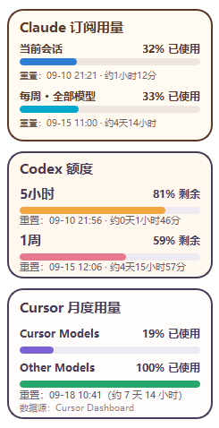

# LLM Usage

面向 Windows 的本地桌面用量组件集合，用于在系统托盘和悬浮卡片中查看 AI 编程工具的订阅用量。



| 应用 | 说明 | 默认数据源 |
| --- | --- | --- |
| `codex-usage` | 显示 Codex 5 小时与本周额度的剩余比例及重置时间 | 本机 Codex 登录状态 |
| `cursor-usage` | 显示 Cursor 本月 Cursor Models、Other Models 已使用比例与账期重置时间 | 本机 Cursor 登录状态（查询 Cursor Dashboard） |
| `claude-usage` | 显示 Claude 5 小时及每周全部模型已使用比例与重置时间 | 本机 Claude 桌面版登录状态 |

三个应用均提供演示、手动输入和 JSON 文件数据源，以便在未登录或排查问题时使用。

## 环境要求

- Windows 10 或 Windows 11
- Python 3.12
- 对应客户端已在本机登录（仅使用默认数据源时需要）

## 快速开始

选择需要运行的子项目，在 PowerShell 中执行：

```powershell
cd .\codex-usage  # 或 .\cursor-usage、.\claude-usage
python -m pip install -r requirements.txt
.\run.bat
```

首次运行后，请在 Windows 系统托盘中寻找应用图标。关闭悬浮卡片只会隐藏窗口；可通过托盘菜单刷新、修改数据源或退出应用。

详细的安装、数据源格式和故障排查说明见子项目文档：

- [Codex 用量组件](codex-usage/README.md)
- [Cursor 用量组件](cursor-usage/README.md)
- [Claude 用量组件](claude-usage/README.md)

## 数据与隐私

三个组件都只在本机读取登录令牌，用于向对应服务发起只读的用量查询；令牌仅保存在进程内存中，不会写入应用配置、日志或界面，也不会刷新或写回。

- **Codex**：读取 `~/.codex/auth.json`，只查询额度接口。
- **Cursor**：读取本机 Cursor 的登录状态；`CURSOR_SESSION_TOKEN` 仅可作为临时环境变量覆盖，不能写入项目文件或应用设置。
- **Claude**：默认数据源 `claude_desktop` 会用 Windows DPAPI 解密 Claude 桌面版 Cookie 库中的 `sessionKey`，查询 claude.ai 用量端点；桌面版运行时会锁住 Cookie 库，此时改从桌面版 `config.json` 的 OAuth 令牌缓存中只解密 access token，查询 Anthropic `/api/oauth/usage`。不读取 `refreshToken`、其它 Cookie 或对话记录。可选数据源 `claude_local` 改读 Claude Code 的 `~/.claude/.credentials.json`。
- 应用设置分别写入 `%APPDATA%\CodexUsageCat`、`%APPDATA%\CursorUsage` 和 `%APPDATA%\ClaudeUsage`，不含任何登录令牌。

## 免责声明

- 本项目是个人开发的非官方工具，与 OpenAI、Anysphere（Cursor）、Anthropic 均无关联，也未获得其认可。Codex、ChatGPT、Cursor、Claude 等名称和商标归各自所有者所有。
- 各组件调用的用量接口（`chatgpt.com/backend-api/wham/usage`、`cursor.com/api/usage-summary`、`claude.ai/api/organizations/{org}/usage`、`api.anthropic.com/api/oauth/usage`）都不是面向第三方公开承诺的稳定 API，字段、鉴权方式或限流策略随时可能变化，导致组件失效。
- 组件会读取并解密本机客户端的登录令牌。请先阅读源码、确认符合你所用服务的条款后再使用，风险自负。
- 反馈问题时，请勿在 Issue 中粘贴任何令牌、Cookie 或含个人路径的诊断输出。

## 开发与验证

三个子项目均为独立 Python 应用，测试必须在各自目录中执行：

```powershell
cd .\codex-usage
python -m unittest discover -s tests -v

cd ..\cursor-usage
python -m unittest discover -s tests -v

cd ..\claude-usage
python -m unittest discover -s tests -v
```

## 目录结构

```text
llm-usage/
├── codex-usage/    # Codex 5 小时与周额度悬浮组件
├── cursor-usage/   # Cursor 月度用量悬浮组件
└── claude-usage/   # Claude 订阅额度悬浮组件
```

## 许可证

[MIT](LICENSE)
