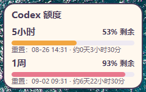

# Codex Usage Dragonfruit

一个 Windows 桌面用量小组件：在屏幕右下角分别显示 Codex 5 小时和本周额度的剩余百分比、额度条与下次重置时间，并在系统托盘提供刷新和退出入口。



## 开始前

你需要：

- Windows 10 或 Windows 11；
- 已安装并登录 Codex（用于读取本机登录状态）；
- Python 3.12；
- 本项目文件夹已下载到电脑。

> 程序不保存或展示 Codex Token。它只读取本机的登录状态，并向 Codex 官方额度端点发送只读请求。

## 第一次使用：按这 4 步操作

### 1. 安装 Python 3.12

1. 点击下载 [Python 3.12.10 Windows 64 位安装包](https://www.python.org/ftp/python/3.12.10/python-3.12.10-amd64.exe)。这是 Python 官方网站提供的安装包；项目的启动脚本会优先使用 Python 3.12。
2. 双击下载的 `python-3.12.10-amd64.exe`。
3. 在第一个安装页面，**勾选 `Add python.exe to PATH`**，再点击 `Install Now`。
4. 等待安装完成后关闭安装器。

如果你的电脑是 ARM 设备，请从 [Python Windows 下载页](https://www.python.org/downloads/windows/) 选择同一版本的 ARM64 安装包。

### 2. 登录 Codex

打开 Codex，按提示完成登录。登录成功后，本机通常会生成 `~/.codex/auth.json`；本程序用它查询你的额度。没有登录时，组件会提示找不到登录状态。

### 3. 安装所需组件

1. 打开本项目的 `codex-usage` 文件夹。
2. 在资源管理器地址栏输入 `powershell`，按 Enter。
3. 在打开的蓝色/黑色窗口中粘贴并执行：

```powershell
python -m pip install -r requirements.txt
```

看到 `Successfully installed` 或类似提示即表示完成。这个步骤通常只需执行一次。

### 4. 启动组件

双击 `run.bat`。首次启动后，请到 Windows 右下角的系统托盘查找火龙果图标；应用关闭窗口后仍会留在托盘，右键图标仅提供“立即刷新”和“退出”。悬浮卡片采用 240 x 132 的紧凑布局，每次显示时都会保持在其他普通窗口之上，且不抢焦点。拖动组件后，位置会在关闭窗口或退出应用时保存，下次启动时恢复。

## 看不到额度怎么办

按下面顺序检查：

1. 确认 Codex 已在这台电脑完成登录。
2. 右键托盘图标，选择“刷新”。
3. 确认电脑可以访问网络。
4. 如果仍失败，确认 Codex 已登录且本机可以访问网络后再次选择“刷新”。

本机 Codex 额度接口同时提供 5 小时窗口时，组件会显示其剩余百分比与重置时间；接口未提供该窗口时显示“待数据源提供”。首次无法获取数据时，界面会显示“暂无数据”；之后某次刷新失败时，仍会保留最近一次成功的数据。

## 开机自动启动（可选）

在 `codex-usage` 文件夹中打开 PowerShell，执行：

```powershell
powershell -ExecutionPolicy Bypass -File .\install_autostart.ps1
```

取消开机启动：

```powershell
powershell -ExecutionPolicy Bypass -File .\install_autostart.ps1 -Uninstall
```

脚本只会修改当前 Windows 用户的开机启动项。

## 常见问题

**双击 `run.bat` 没有反应？**

先完成“安装所需组件”，再在 PowerShell 中运行 `python app.py`。窗口会显示具体报错，便于判断是 Python 未安装还是依赖未安装。

**提示 `python` 不是内部或外部命令？**

Python 安装时没有加入 PATH。重新运行 Python 安装包，选择 `Modify`，勾选 `Add Python to environment variables`；然后重新打开 PowerShell。

**程序会上传我的 Token 吗？**

不会。代码仅从 `~/.codex/auth.json` 读取 `access_token` 和 `account_id`，用于向 `https://chatgpt.com/backend-api/wham/usage` 发起只读查询；Token 不会写入设置、日志或界面。

## 开发与验证

```powershell
python -m unittest discover -s tests -v
```
