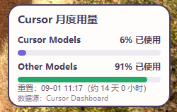

# Cursor Usage

一个 Windows 桌面用量面板：显示 Cursor 当月的 Cursor Models/Other Models 已用比例和账期重置时间，并在系统托盘提供刷新和退出入口。百分比按 Cursor Dashboard 的规则向上取整。



## 开始前

你需要：

- Windows 10 或 Windows 11；
- 已安装并登录 Cursor；
- Python 3.12；
- 本项目文件夹已下载到电脑。

> Cursor 没有面向个人订阅公开的用量 API。本程序从 Cursor 本机登录状态查询 Dashboard 数据；登录信息只在内存中使用，不会写入设置、日志或界面。

## 第一次使用：按这 4 步操作

### 1. 安装 Python 3.12

1. 点击下载 [Python 3.12.10 Windows 64 位安装包](https://www.python.org/ftp/python/3.12.10/python-3.12.10-amd64.exe)。这是 Python 官方网站提供的安装包；项目的启动脚本会优先使用 Python 3.12。
2. 双击下载的 `python-3.12.10-amd64.exe`。
3. 在第一个安装页面，**勾选 `Add python.exe to PATH`**，再点击 `Install Now`。
4. 等待安装完成后关闭安装器。

如果你的电脑是 ARM 设备，请从 [Python Windows 下载页](https://www.python.org/downloads/windows/) 选择同一版本的 ARM64 安装包。

### 2. 登录 Cursor

打开 Cursor，使用你的账号完成登录，再完全退出一次 Cursor 并重新打开。程序会从 Cursor 的本机登录状态读取会话；未登录或登录过期时会给出提示。

### 3. 安装所需组件

1. 打开本项目的 `cursor-usage` 文件夹。
2. 在资源管理器地址栏输入 `powershell`，按 Enter。
3. 在打开的蓝色/黑色窗口中粘贴并执行：

```powershell
python -m pip install -r requirements.txt
```

看到 `Successfully installed` 或类似提示即表示完成。这个步骤通常只需执行一次。

### 4. 启动面板

双击 `run.bat`。首次启动后，请到 Windows 右下角的系统托盘查找图标；关闭窗口后应用仍会留在托盘，右键图标仅提供“立即刷新”和“退出”。面板每次显示时都会保持在其他普通窗口之上，且不抢焦点。拖动面板后，位置会在关闭窗口或退出应用时保存，下次启动时恢复。

## 看不到用量怎么办

按下面顺序检查：

1. 确认 Cursor 已在这台电脑完成登录。
2. 退出 Cursor 后重新打开并再次登录。
3. 右键托盘图标，选择“刷新”。
4. 确认电脑可以访问网络。
5. 若仍失败，可修改 `%APPDATA%\CursorUsage\settings.json` 中的数据源为“演示”，确认程序能正常显示。

Cursor 更新后 Dashboard 接口可能变化；这时可先使用“手动”或“JSON 文件”数据源。

首次无法获取数据时，面板会显示暂无数据；本次运行中一旦成功获取过用量，后续刷新失败时仍会展示最近一次成功数据，并在数据源状态中附带本次失败原因。缓存仅保存在内存中，退出应用后清空。

## 数据源设置

普通用户保持默认的“Cursor Dashboard”即可；如需切换数据源，可修改 `%APPDATA%\CursorUsage\settings.json`。

| 类型 | 适用场景 |
| --- | --- |
| Cursor Dashboard（默认） | 已在本机登录 Cursor，自动读取当月用量。 |
| 演示 | 只想确认界面是否能正常显示。 |
| 手动 | 自己填写 Cursor Models 和 Other Models 的已用百分比。 |
| JSON 文件 | 从你指定的 JSON 文件读取数据。 |

设置保存在 `%APPDATA%\CursorUsage\settings.json`，其中不包含 Cookie。默认每 30 秒后台刷新一次，最短间隔为 30 秒。

### JSON 文件格式（可选）

```json
{
  "auto_used_percent": 11,
  "api_used_percent": 81,
  "reset_at": "2026-08-01T09:00:00+08:00",
  "plan": "Pro",
  "message": "示例数据"
}
```

## 常见问题

**双击 `run.bat` 没有反应？**

先完成“安装所需组件”，再在 PowerShell 中运行 `python app.py`。窗口会显示具体报错，便于判断是 Python 未安装还是依赖未安装。

**提示 `python` 不是内部或外部命令？**

Python 安装时没有加入 PATH。重新运行 Python 安装包，选择 `Modify`，勾选 `Add Python to environment variables`；然后重新打开 PowerShell。

**提示 Cursor 未登录或登录过期？**

在 Cursor 中退出账号后重新登录，再点击托盘菜单的“立即刷新”。如果仍无法读取，可修改 `%APPDATA%\CursorUsage\settings.json` 使用“手动”或“JSON 文件”数据源。

**需要手动提供 Cookie 吗？**

通常不需要。仅在临时排查时，才可在启动前设置 `CURSOR_SESSION_TOKEN` 环境变量；不要把 Cookie 发给他人，也不要写入项目文件。

## 开发与验证

```powershell
python -m unittest discover -s tests -v
```
